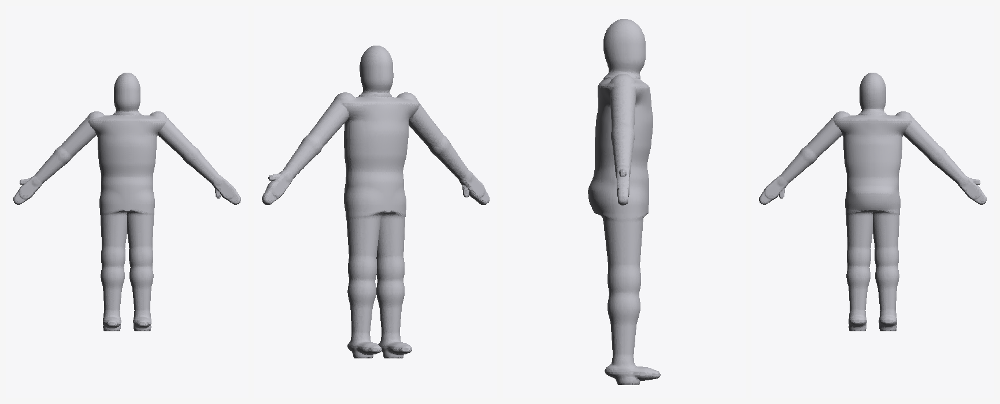
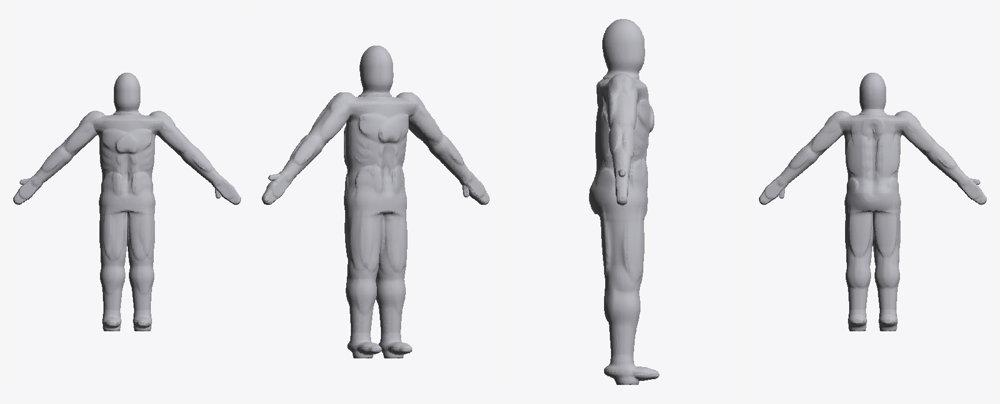
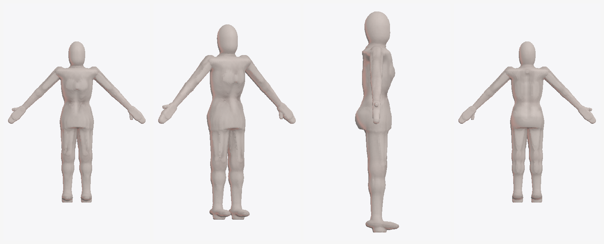

# pxhuman — parametric synthetic human body generator

Generates a watertight, rigged, measurement-accurate 3D body mesh from numeric
anthropometric parameters. Nothing in this package derives shape, texture or
identity from a photograph or from any real individual; the head is a generic
ovoid with no facial features.



`--definition 0` — the smooth base mesh.



`--definition 0.9 --muscle 0.75 --bodyfat 0.32` — same measurements, muscle
layer on.



`--proportion 1.0 --definition 0.35 --skin --tone II` — second proportion
template with the skin layer. The head is a featureless ovoid in every
configuration; no facial features are generated.

## Quick start

Install once:

```
pip install numpy scipy scikit-image trimesh shapely pillow
```

Then generate and render. These are single lines — they work in PowerShell,
cmd and any POSIX shell:

```
python generate.py --stature 178 --chest 104 --waist 92 --hip 101 --shoulder-width 47 --quality high --out out/body
python render.py out/body.obj out/preview.png
```

If you want to split the command across lines, the continuation character
differs by shell: `\` in bash/zsh, a backtick `` ` `` in PowerShell, `^` in cmd.
Mixing them up is why a pasted multi-line command fails with
`unrecognized arguments: \`.

Outputs `body.obj`, `body.stl`, `body.glb`, `body_rig.json`, `body_report.json`
and `import_pxhuman.py`.

## How it works

**Measurements → landmarks.** Segment lengths not supplied by the caller are
derived from stature using the Drillis & Contini ratio table. Two neutral
proportion templates are blended by `--proportion`; `--muscle` and `--bodyfat`
bias girth distribution.

**Torso.** A lofted generalised cylinder. Each control cross-section is an
ellipse modulated by anterior projection, posterior flattening, gluteal
projection and lateral squaring, then **renormalised numerically so its closed
curve perimeter equals the requested girth exactly.** Sections are interpolated
with a PCHIP spline into a (height × angle) radius table.

**Limbs.** Tapered round cones and ellipsoids combined with a polynomial smooth
minimum, then marching-cubed into a single manifold.

**Calibration.** Smooth blending perturbs torso girth by up to a few percent,
and by an amount that depends on the parameter combination. Rather than assume
it away, `calibrate()` builds the mesh, measures its own cross-sections, and
solves multiplicative profile gains. Converges in 2–3 passes.

**Muscle layer** (`--definition 0..1`, default 0). Around 40 muscle bellies —
pectorals, rectus abdominis, obliques, serratus, trapezius, latissimus,
erector spinae, three deltoid heads, biceps, triceps, forearm flexor and
extensor mass, quadriceps with vastus lateralis and medialis, hamstrings,
adductors, gastrocnemius heads, tibialis — plus the linea alba and spinal
furrow as smooth subtractions.

Each belly queries the *generated* surface at its anchor (the torso profile at
a height and angle, or the limb taper at a parameter along the segment), then
sits so it protrudes by a controlled depth. Relief therefore follows whatever
form the measurements produced instead of assuming coordinates.

Two properties make the layer safe rather than fragile:

- **Shell clamping.** Every belly is smooth-maximised against the current
  field minus a margin, so it can only ever exist within a thin shell of the
  surface. Without it a belly anchored on an analytic estimate floats free
  wherever the real blended surface differs, and a belly wide enough to wrap
  the body surfaces again on the far side as a detached blob.
- **Fat masking.** Amplitude falls with `--bodyfat`, as it does in life.

Girth is left to the calibration pass, which re-solves the torso profile
against the *muscled* surface — so adding relief does not silently inflate the
requested chest, waist or hip. Measured error with relief at full strength
stays under 0.25%.

**Skin layer** (`--skin`). Per-vertex colour from a numeric tone model, with
`--tone` (Fitzpatrick-style presets I–VI), `--redness` and `--translucency`.
Tone is modulated by position: more blood perfusion at joints and extremities,
a cooler paler abdomen, subsurface colour bleeding through thin convex
regions, and occlusion that warms as it darkens rather than just darkening.
Exports vertex colours in GLB/PLY, a cylindrical UV set, and an `.npz`
sidecar with the raw colour, AO, roughness and UV channels.

Ambient occlusion is computed **from the distance field**, not by ray
casting. The field is already in hand, so marching a few steps along each
vertex normal and comparing the field value against the distance travelled
gives the standard SDF occlusion estimate for a fraction of the cost. It is
then Laplacian-smoothed across the mesh — sampled raw it picks up the
sub-millimetre C1 seam where a clamped muscle belly meets the surface and
renders it as a scratch.

**Rig.** 25 joints in a standard hierarchy, inverse-distance linear blend
skinning against bone segments, 4 influences per vertex, with pose presets
(`a_pose`, `t_pose`, `relaxed`, `stride`, `sit`).

## Verification

Every run audits itself and writes the result into `body_report.json`:
girths measured by integrating actual mesh cross-sections, plus watertightness,
genus, component count and volume.

Validation sweep across the parameter envelope — all ten cases genus 0,
watertight, single component:

| case | genus | volume | chest | waist | hip |
|---|---|---|---|---|---|
| template A 172 | 0 | 82.7 L | +0.00% | −0.07% | +0.05% |
| template B 165 | 0 | 70.2 L | +0.02% | −0.06% | −0.00% |
| A 188 heavy | 0 | 141.9 L | +0.01% | −0.01% | +0.17% |
| A 190 max | 0 | 183.8 L | +0.02% | −0.01% | +0.72% |
| B 180 heavy | 0 | 127.2 L | +0.02% | +0.02% | +0.03% |
| B 155 slim | 0 | 46.9 L | +0.00% | −0.07% | +0.01% |
| B 150 min | 0 | 33.0 L | +0.04% | +0.06% | −0.00% |
| explicit 178 | 0 | 95.4 L | +0.02% | +0.00% | +0.05% |
| T-pose 175 | 0 | 87.2 L | +0.01% | −0.02% | +0.05% |
| arms down 175 | 0 | 86.9 L | +0.02% | −0.02% | +0.05% |

With the muscle layer on, across definition, muscle and bodyfat extremes —
all genus 0, watertight, single component:

| case | genus | volume | chest | waist | hip |
|---|---|---|---|---|---|
| definition 0.0 | 0 | 88.0 L | +0.01% | +0.05% | +0.04% |
| definition 0.5 | 0 | 88.9 L | +0.21% | +0.15% | +0.11% |
| definition 1.0 lean | 0 | 97.1 L | −0.01% | +0.01% | +0.21% |
| definition 1.0 heavy | 0 | 138.6 L | +0.21% | +0.01% | +0.76% |
| muscle 1.0 bodyfat 1.0 | 0 | 150.3 L | +0.07% | −0.05% | +1.15% |
| definition 1.0, 150 cm | 0 | 32.4 L | −0.05% | +0.01% | −0.01% |
| definition 1.0, 195 cm | 0 | 139.0 L | +0.14% | −0.14% | +0.28% |
| definition 1.0 T-pose | 0 | 111.6 L | +0.18% | +0.05% | +0.39% |
| definition 1.0 arms down | 0 | 111.1 L | +0.20% | +0.03% | +0.39% |

### Topology notes

Six failure modes were found and fixed during validation, each worth knowing
if you modify the field. The last two were found only after the muscle layer
widened the parameter grid — and one of them turned out to be a pre-existing
base-geometry defect that the original sweep had simply never exercised:

1. **Feet fusing across the midline.** Ankle separation is now floored at
   `foot_breadth·0.62 + 0.022·H`. Without it the two feet merge, the legs form
   a closed ring and genus goes to 1.
2. **The armpit ringing shut.** On heavy builds a smooth-blended upper arm
   bridges to the ribcage a second time below the shoulder. The upper arm now
   uses a hard union; only the deltoid sphere blends.
3. **Inner thighs and calves webbing while the knees stay apart.** Each side's
   limbs are now blended onto its own copy of the midline field and the two
   sides combined with a hard union, so opposite limbs can never blend.
6. **Paper-thin shards at the muscle clamp seam.** Where a clamped belly runs
   almost tangent to the surface, a fine enough voxel resolves a sliver of
   near-zero volume. Four appeared at 0.60 cm and none at 0.85 cm — finer
   resolution made it *worse*, which is the tell for a tangency artefact
   rather than a modelling error. The clamp smoothing was widened, and
   `clean_mesh` now drops sub-threshold fragments and **reports** them; a
   fragment that is not tiny still shows up, because that would mean
   something real is detaching.

4. **Muscle bellies detaching into free-floating blobs.** A belly anchored on
   an analytic surface estimate floats off wherever the real blended surface
   differs, and a belly widened enough to keep its visible size while sunk
   deep wraps the body and surfaces again on the far side. One test produced
   seven components. Shell clamping fixed both; see the muscle layer above.
5. **Legs touching a second time at the calf.** The stance floor accounted
   only for foot breadth, so on a thick-limbed build the knees and calves
   became the narrow point: the thighs met at the top, the knees cleared, and
   the calves touched again — ringing a hole. The floor now also solves for
   knee and calf radius. This was a *base geometry* bug, reproducible with
   `--definition 0`; the muscle work only widened the parameter grid enough
   to surface it.

A note on diagnosing these: every one of them was found by measuring, not by
inspection. Component count and genus are cheap to compute and they localise
the fault immediately — `components=7` says bellies are detaching, a genus
that appears at one body size and vanishes at a larger one says a gap is
closing marginally rather than a rule being wrong. Ablation (rebuilding with
`--definition 0`, or with a part of the field disabled) is what separates a
new bug from an old one.

### Measurement pose

Girths are solved and audited with the arms abducted to at least 75°, then the
body is built in whatever pose was requested. With the arms lowered a
horizontal slice cuts through them and the perimeter is meaningless — the same
reason real anthropometry specifies a pose. Slices that merge with the arms are
reported as unmeasurable rather than given a wrong number.

## Blender

```
blender --python out/import_pxhuman.py -- out/body.obj out/body_rig.json
```

On Windows, `blender` must be on PATH or called by full path, e.g.
`& "C:\Program Files\Blender Foundation\Blender 4.2\blender.exe"`.

Builds the armature, parents the mesh, writes weights into vertex groups, and
converts centimetres to metres with Z-up.

## Making an avatar speak

`talk.py` writes a glTF animation into an avatar that already carries viseme
blendshapes (MetaPerson, or any rig with the standard 15-viseme set):

```
python talk.py avatar/model.glb "Good morning. How can I help you today?" --out out/talking.glb
python verify_talk.py out/talking.glb out/talk_check.png
```

Text is converted to ARPAbet phonemes via the CMU dictionary, mapped to the
15 visemes (`PP FF TH DD kk CH SS nn RR aa E ih oh ou sil`), given nominal
durations, and blended with overlapping raised-cosine envelopes — visemes
overlap rather than switch, because a mouth shape starts forming before its
sound and relaxes after it. Without that overlap the result reads as a
flipbook of poses rather than speech. Jaw opening and lip rounding are derived
from the viseme mix; blinks run on a deliberately irregular cadence, and a
small continuous head motion is layered over the neck chain.

The animation is written by editing the glTF JSON and binary chunk directly,
so the avatar's skin, joints, materials and morph targets survive untouched.

**The viseme track is the seam.** Audio2Face emits weights over the same
viseme names from audio; swap the generator in `lipsync.py` for its output and
nothing downstream changes.

### Arabic

`--lang` defaults to `auto` and detects Arabic script.

Arabic writes short vowels only as optional diacritics, and most real text
carries none. They are read when present and inferred when absent — a wrong
short vowel moves the jaw slightly too far, while a missing one stops the
mouth entirely, so the inference is worth making. Shadda lengthens, tanween
becomes a vowel plus a final nuun (including when written over the alif, as
in شكراً), and the definite article assimilates into a following sun letter.

Emphatics (ص ض ط ظ) and pharyngeals (ح ع) share visemes with their plain
counterparts: they differ in tongue root and pharynx, which the lips do not
show.

### Body animation

`--body clip.glb` merges a skeletal clip. Mixamo downloads FBX, which only
Blender reads reliably, so `fbx2glb.py` converts it:

```
python fbx2glb.py Angry.fbx
python talk.py avatar/model.glb "..." --body Angry.glb --out out/angry.glb
```

It needs Blender installed but not on PATH: run with ordinary Python, it
looks for `--blender`, then `$BLENDER`, then PATH, then the usual install
folders on Windows, macOS and Linux (newest version first), and re-runs
itself inside Blender. With the `bpy` module installed it converts
in-process. Several files convert in one call; meshes are dropped unless
`--keep-mesh`, since a clip needs only the skeleton and its motion.

Download from Mixamo as FBX Binary, 30 fps, keyframe reduction none;
"Without Skin" gives the smallest file.

Speech sets the animation's length, and a shorter clip loops. To play a clip
exactly once, fit the speech to it with `--rate`: the duration line reports
the length, and duration scales as 1/rate. MetaPerson's skeleton already uses Mixamo's bone
names, so bones match directly and `mixamorig:` prefixes are stripped.

Matching names is not matching rotations. A node's rotation is expressed in
its rig's own bone axes, and those differ: MetaPerson's thigh carries a ~177°
rest rotation because its bone axis points down the leg, while a rig built
with identity rests carries none. An earlier version copied local rotations
by name, which turned the legs upside down, and copied the hips' absolute
position, which dropped the avatar 94 cm into the floor.

The clip is therefore transferred as motion in world space
(`pxhuman/bodyanim.py`):

```
delta(t) = Ws(t) · Ws_rest⁻¹          how each source bone moved
Wt(t)    = delta(t) · A · Wt_rest     the same motion on the avatar
local(t) = Wt_parent(t)⁻¹ · Wt(t)     back into the avatar's hierarchy
```

`A` aligns the two rest *poses*, and only where they really are different
poses. Two rigs never share an anatomy: against Mixamo, MetaPerson's spine
curves 19° further, its foot bone points 22° lower and its clavicles sit 37°
higher. Those are shapes. An earlier version aligned every bone's direction,
which bent the avatar into Mixamo's body; the feet alone tipped the toes
4.6 cm through the floor. A pose difference (arms in an A-pose against a
T-pose, legs spread) shows at the root of a limb, so alignment is applied
only at the upper arms and thighs, and only above 10°. It is one rotation
per limb, fitted over every joint below the root (Kabsch), because a single
bone direction leaves the twist free and the hand would land rotated around
the arm. `talk.py` prints what it did:

```
rest pose   aligned LeftArm 11deg, RightArm 11deg (46 bones differ in shape only, up to 37deg; kept as the avatar's own)
```

The 11° is MetaPerson's rest elbows, which are bent where Mixamo's are
straight; an A-pose clip reports about 40°. `--no-rest-align` turns
alignment off. Rest rotations are read from the skin's inverse bind matrices
where present, since a file saved mid-animation can carry posed node values.

`--root-motion` moves the hips by the clip's displacement from its *own*
rest position, scaled by the ratio of leg lengths, so centimetre rigs under
a 0.01 root and rigs built at the origin both land correctly.

Where both the clip and the speech want the neck and head, the body pose is
the base and the speech motion composes on top of it as a delta, rather than
one silently overwriting the other.

```
python verify_retarget.py avatar/model.glb out/retarget_check.png
```

builds three source rigs from the avatar's joints — the avatar's own rig, an
identity-rest centimetre rig, and the same in an A-pose — drives them with a
known motion, and checks every bone's world direction on the avatar against
the source (error ≤ 0.01°), the hips displacement (exact), that the skinned
figure stays upright and on its floor, and that rest alignment flags only the
arms. A negative control runs the old copy-by-name transfer and must fail
(178° error, hips 95 m off).

### Audio2Face

`--a2f weights.csv` drives the mouth from audio instead of text. A2F emits
ARKit blendshape weights and the avatar carries the full ARKit set, so the
weights map by name with no viseme conversion in between.

The integration is built around the weights rather than a transport: A2F runs
as a cloud endpoint, a local NIM container, or the Maya and Unreal plugins,
and all of them can produce a table of weights over time. `pxhuman/a2f.py`
also contains a network client, which is **untested** — it needs credentials
and a GPU endpoint. Prefer a weights file from the official sample client.

`verify_talk.py` is the check that matters: it reads the morph targets back
out of the written file, applies the animated weights, and renders the mouth.
A file that writes without an exception is not evidence that anything moves.
When the animation drives the body it also poses the skeleton, skins the
meshes, and fails if the feet rise above the hips, the head drops below
them, or the figure sinks through its floor or collapses — the mouth check
alone passed a file whose legs pointed at the sky.

## Known limits

- The browser viewer builds its preview from parametric surfaces rather than
  the distance field, so it shows the smooth base form only. The muscle layer
  exists in the Python pipeline.

- Hands default to a mitt with a separated thumb. `--hands fingers` needs
  `--quality ultra`; below ~0.45 cm voxels the gaps between digits do not
  resolve and the fingers fuse into webbing with spurious handles.
- Stature measures ~0.5% over target: marching cubes places the isosurface a
  fraction of a voxel outside the true zero level at the crown and sole.
  Scale uniformly if you need it exact.
- Skinning is inverse-distance, good enough for a base rig. Production
  deformation wants heat-diffusion weights and corrective shapes.
- Marching cubes gives uniform-density triangles with no edge loops and no UVs.
  Retopologise if you need animation-grade topology.

## Files

```
pxhuman/anthro.py   parameters, ratio tables, landmark resolution
pxhuman/sdf.py      distance primitives, torso profile, field assembly, skeleton
pxhuman/muscles.py  anatomical relief layer, shell clamping, surface anchoring
pxhuman/mesh.py     volume sampling, surface extraction, calibration, audit
pxhuman/rig.py      bones, skinning weights, posing, presets
pxhuman/export.py   OBJ / STL / GLB / rig JSON / Blender importer
pxhuman/skeleton.py glTF hierarchy: bind-pose rest, posed world transforms, skinning
pxhuman/bodyanim.py body clip loading and world-space retargeting
fbx2glb.py          FBX clip -> GLB through Blender, found automatically
verify_retarget.py  retargeting checks against rigs with known answers
generate.py         CLI
render.py           offscreen preview renderer
viewer/index.html   interactive browser preview with live sliders
```
